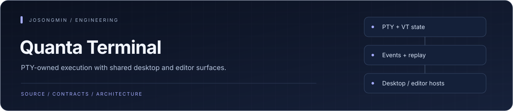
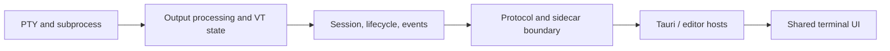

<p align="center"></p>

# Quanta Terminal

<p align="center"><a href="#engineering-highlights">Engineering</a> · <a href="#architecture">Architecture</a> · <a href="#development">Get started</a> · <a href="#contracts-worth-reading">Reference</a></p>

A terminal-first architecture with a Rust core and TypeScript interface. It preserves PTY behavior while supporting standalone and IDE-embedded hosts. AI integration is optional rather than the center of the terminal execution model.

[Product spec](docs/product-spec.md) · [Architecture](docs/technical-architecture.md) · [Testing](TESTING.md) · [Release guide](docs/RELEASE.md)

## Engineering highlights

| Mechanism | Engineering purpose | Source |
| :--- | :--- | :--- |
| **PTY and terminal state ownership** | Rust crates own PTY execution, output processing, VT state, session lifecycle, and terminal contracts. | [PTY crate](crates/quanta-pty/) |
| **Host-independent integration** | Desktop and editor hosts adapt a shared engine instead of making the UI the execution authority. | [Host contracts](packages/host-common/) |
| **Event and replay contracts** | Dedicated event, protocol, lifecycle, and replay components make session reconstruction an explicit architecture concern. | [Event crate](crates/quanta-events/) |
| **Mechanical boundary checks** | The workspace includes checks for FSD layering, event topics, rendering/input paths, protocol compatibility, and performance budgets. | [Render-path check](tools/check-one-render-path/) |

## Architecture

<a id="architecture-at-a-glance"></a>



| Area | Responsibility |
| --- | --- |
| Rust core | PTY, output processing, blocks, sessions, lifecycle, events, and protocol |
| Security | Sensitive-data detection, redaction, and execution-boundary policy |
| TypeScript UI | Terminal/workspace interface and deterministic event reduction |
| Host adapters | Shared host behavior and Tauri desktop composition |
| Operational tooling | Replay, protocol fixtures, structural checks, and performance budgets |

Source ownership is split across [crates](crates), [packages/ui](packages/ui), [packages/host-common](packages/host-common), and [packages/host-tauri](packages/host-tauri). The frontend follows feature-sliced boundaries; the backend follows ports/adapters boundaries.

## Development

Use Node.js 20.10+, pnpm 9.12.0, the repository Rust toolchain, and platform dependencies for Tauri.

```sh
pnpm install --frozen-lockfile
pnpm dev
```

The root development command targets the Tauri host package. Core/service and real-socket test setup are documented in [TESTING.md](TESTING.md).

```sh
pnpm typecheck
pnpm lint
pnpm test
pnpm check:layering
```

Rust integration and PTY/socket tests are separate from TypeScript workspace tests. Performance budgets require the configured environment; a local timing signal is not a cross-platform latency guarantee.

## Package the desktop application

```sh
pnpm package-sidecar
pnpm --filter @quanta/host-tauri tauri build
```

The packaged application bundles `quanta-core` through Tauri's `externalBin`; end users do not need a separate binary on `PATH`. Environment override, bundled-resource, and `PATH` resolution behavior is described by the testing/release documentation.

Version tags select the release workflow. Signing, notarization, updater manifests, and platform credentials require their own configuration. Nightly bundles and source builds are not equivalent to a signed release.

## Contracts worth reading

- [Host modes](docs/adr/0001-host-modes.md)
- [Execution boundary](docs/adr/0002-execution-boundary-contract.md)
- [Session metadata](docs/adr/0003-session-metadata-truth-model.md)
- [Sidecar lifecycle](docs/adr/0004-sidecar-lifecycle-contract.md)
- [Storage and retention](docs/adr/0005-storage-and-retention.md)
- [Sensitive data](docs/adr/0006-secret-and-sensitive-data-policy.md)
- [Raw/TUI semantics](docs/adr/0008-raw-tui-mode-semantics.md)
- [Event replay and reduction](docs/adr/0011-event-replay-and-reducer-semantics.md)
- [Repository architecture](docs/adr/0014-repository-structure.md)
- [Benchmark protocol](docs/benchmark-protocol.md) and [comparison matrix](docs/terminal-benchmark-matrix.md)

<p align="center"><sub><a href="https://github.com/josongmin">Project map</a> · <a href="#engineering-highlights">Back to overview</a></sub></p>
